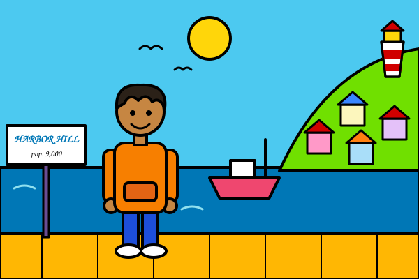
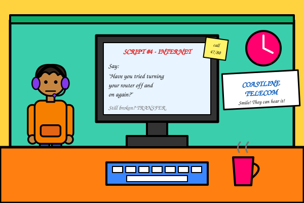
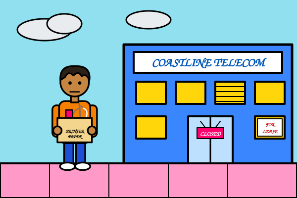
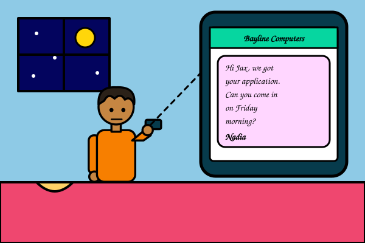
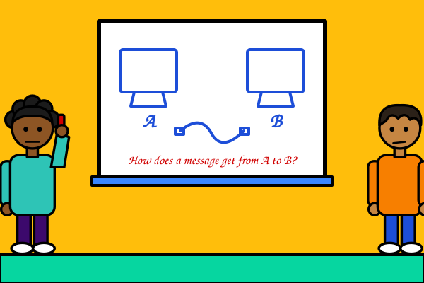
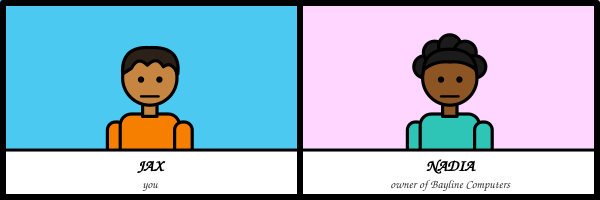
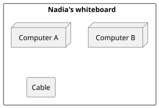
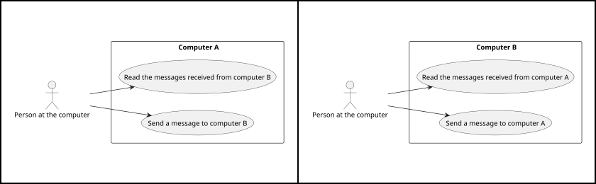

# Introduction

You're **Jax**, 24 years old. You live in Harbor Hill, a fishing town of about 9,000 people. You rent a one-bedroom apartment over a bakery. The heater only works on the lowest setting, and the landlord hasn't called back about it.

  
   <em>You, on the boardwalk in Harbor Hill.</em>

After high school, you applied to six places. The Coastline Telecom call center called back first, and it paid 15 corins an hour. For three years you answered internet complaints from a script, which always opened the same way. *"Have you tried turning your router off and on again?"* Most calls ended there. The rest went to a technician, and you never heard how they turned out.

  
   <em>Your old desk at Coastline Telecom. Call 47 of 80.</em>

Then, one Thursday afternoon, a manager from head office called all 42 of you into the break room. He read from a printed page. The Harbor Hill center would close in two weeks, and the calls would be answered overseas. Nobody asked questions. On your last day, you packed your desk into a printer-paper box. A mug, a phone charger, a dead plant. How long does it take to clear out three years? About ten minutes.

  
   <em>Your last day at Coastline Telecom.</em>

Since then, you've sent out 14 applications. Rent is 650 corins, due on the 1st, and you have 410 in the bank. Most places never answered. Then one evening a message came from Nadia, who runs Bayline Computers, a small repair shop near the harbor. She needs someone for the counter and simple repairs. Could you come in on Friday morning?

  
   <em>The only answer so far.</em>

The interview took ten minutes. Nadia asked about Coastline, and you told her about the router script. Then she picked up a marker and drew two computers on the whiteboard, A and B, with a cable lying between them. "No router, no internet. Just these two. How does a message get from A to B?" You started talking about Wi-Fi, and she shook her head. "Draw it for me. Bring it on Monday."

  
   <em>Nadia's whiteboard at Bayline Computers.</em>

# Context

  
   <em>The people in this story.</em>

Bayline Computers is one room with a counter, shelves of laptops waiting for repair, and a whiteboard behind the counter. Nadia's question lives on that whiteboard. Computer A and computer B sit side by side, and the cable isn't plugged into either of them.

  
   <em>What Nadia drew.</em>

  
   <em>What each computer is for.</em>

# The problem

## Problem 1: A and B know nothing about each other

The two computers on Nadia's whiteboard know nothing about each other. Whatever happens on A stays on A. Nadia wants A to send a message to B, and B to send a message back to A. Each computer should keep the messages it has received, so you can check later what arrived. Right now, the only way to get a note from A to B is to copy it onto a USB stick and walk it over. How does a message leave one computer and show up on the other?

## Constraints

- There are only these two computers. No other devices, no internet.
- You can connect A and B with one cable.
- Forget about Packet Tracer for now. This is about the idea, not the tool.

# Your task

Design a way for A and B to exchange messages.

# What to deliver

A drawing of your design, ready to show Nadia on Monday. I suggest [draw.io](https://app.diagrams.net/), but any drawing tool works. The drawing must show these things.

- Computer A, computer B and how they're connected.
- A few messages sent between A and B, in both directions.
- What each message looks like while it travels from one computer to the other.
- The list of messages each computer has received at the end.
