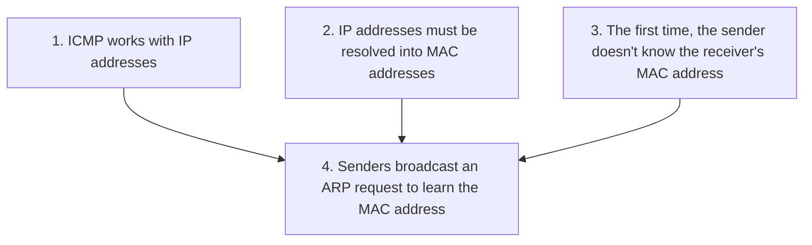
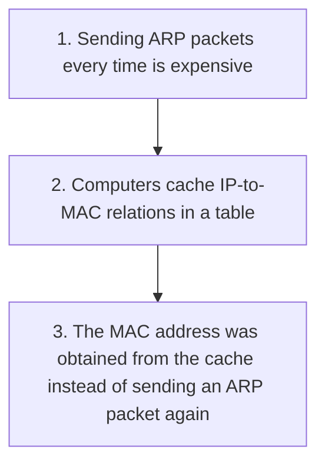

# PKT
- IPv4: a version with IPv4 ([solution_1_icmp_ipv4.pkt](pkt/solution_1_icmp_ipv4.pkt))
- IPv6: a version with IPv6 ([solution_1_icmp_ipv6.pkt](pkt/solution_1_icmp_ipv6.pkt))
# Decisions
## Copper cross-over as cable
- Leo's computer and Mia's computer are both PCs. They are the same type of device, so we can use a cross-over cable.
## Ethernet as interface
- Cross-over cables are a type of Ethernet cable, so they connect to the Ethernet interface.
## IPv4 as IP version
- IPv4, because it's more common, but IPv6 works too.
## ICMP as a way to check the communication
- The ping command sends ICMP packets. ICMP is the standard way to solve this kind of situation.
# Things that caught my attention
## An ARP packet appears before the first ICMP packet
- Before the first ICMP packet was sent, an ARP packet was sent.
![[Pasted image 20261116162132.png]]
### Justification

## No ARP packet appears after the first ping
![[Pasted image 20261116163722.png]]
### Justification

# Sources
- [Packet Tracer help: logical workspace](https://tutorials.ptnetacad.net/help/default/workspace_logical.htm)
- [Packet Tracer help: connections and links](https://tutorials.ptnetacad.net/help/default/connectionsLinks.htm)
- [Packet Tracer help: simulation mode](https://tutorials.ptnetacad.net/help/default/mode_simulation.htm)
- *The TCP/IP Guide* (Charles M. Kozierok): OSI Reference Model chapters
- *The TCP/IP Guide* (Charles M. Kozierok), Part II-2: ARP
- *The TCP/IP Guide* (Charles M. Kozierok), Part II-6: ICMP
- [Cloudflare: What is an IP address?](https://www.cloudflare.com/learning/dns/glossary/what-is-my-ip-address/)
