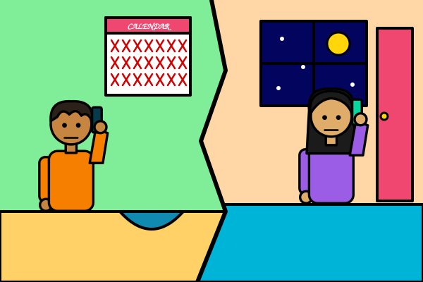
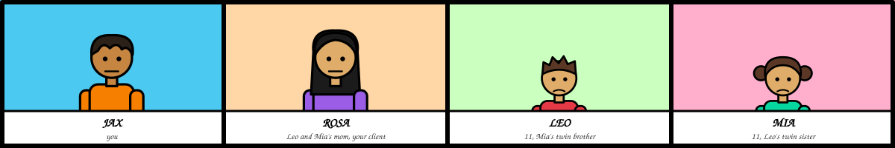
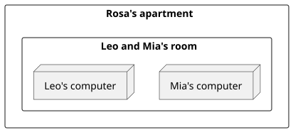
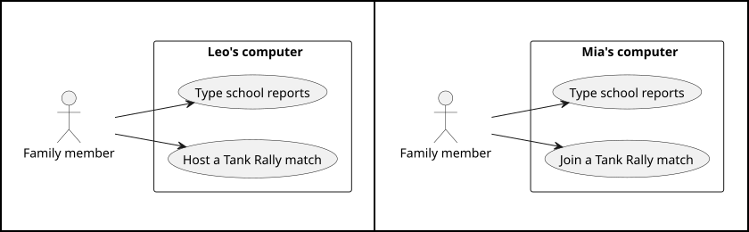
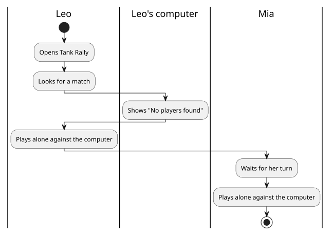

# Context

Three weeks after the flyers went up, your phone rang. It was Rosa, who had pulled a tab off your flyer at Marlow's Coffee. Her twins, Leo and Mia, have one computer each, and since the spring the two computers can't find each other. She offered 25 corins to come by on Saturday morning. You're still 240 short of rent.

  
   <em>Yesterday evening.</em>

  
   <em>The people in this story.</em>

Rosa rents a two-bedroom apartment with Leo and Mia, who are 11. The twins share the smaller bedroom. Their two computers sit on two desks, side by side, about a meter apart.

  
   <em>Leo and Mia's room today.</em>

  
   <em>What each device is for.</em>

# The problem

## Problem 1: Leo's computer and Mia's computer can't find each other

Until the spring, both computers were plugged into the Coastline Telecom router in the hallway, and the twins played Tank Rally against each other. Then Rosa cancelled the internet to save 45 corins a month, and the router went back to Coastline. Since then, Tank Rally shows "No players found" on both computers. Two computers, a meter apart, and neither knows the other one exists. Now the twins take turns: one plays alone against the computer, and the other waits on the bed.

  
   <em>How Leo and Mia play Tank Rally today.</em>

## Constraints

Rosa bought network cables at the hardware store, and that's everything she has. You can use any of them. She won't buy anything else, and she won't pay for the internet again.

## What Rosa wants

- From Leo's computer, Mia's computer answers.
- From Mia's computer, Leo's computer answers.

# Your task

* Make Leo's computer and Mia's computer find each other again in Cisco Packet Tracer, using `PC-PT` for both.
* Prove it. Packet Tracer can't run Tank Rally, so the two computers answering each other is enough. Rosa won't pay 25 corins for "I think it's fine now."

# What to deliver

- `solution.pkt`, your Packet Tracer file, with the two computers working
- `SOLUTION.md`, where you
    1. Justify the decisions you took to solve the problem and build the network.
    2. (Optional) Show the things that caught your attention in Packet Tracer, along with their explanation.
    3. (Optional) Write about your experiments.

# Useful material

- [Packet Tracer help: logical workspace](https://tutorials.ptnetacad.net/help/default/workspace_logical.htm)
- [Packet Tracer help: connections and links](https://tutorials.ptnetacad.net/help/default/connectionsLinks.htm)
- [Packet Tracer help: simulation mode](https://tutorials.ptnetacad.net/help/default/mode_simulation.htm)
- *The TCP/IP Guide* (Charles M. Kozierok): OSI Reference Model chapters
- [Cloudflare: What is an IP address?](https://www.cloudflare.com/learning/dns/glossary/what-is-my-ip-address/)
