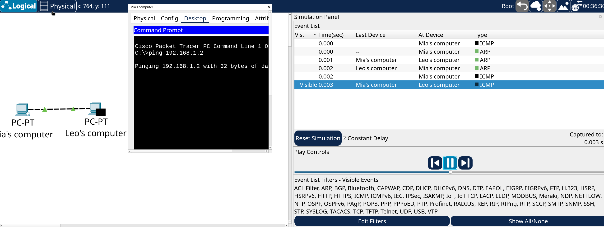
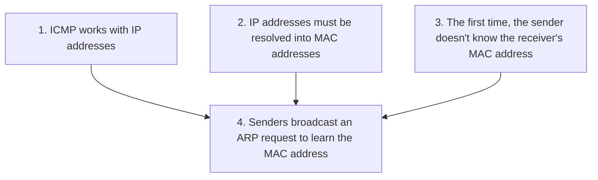
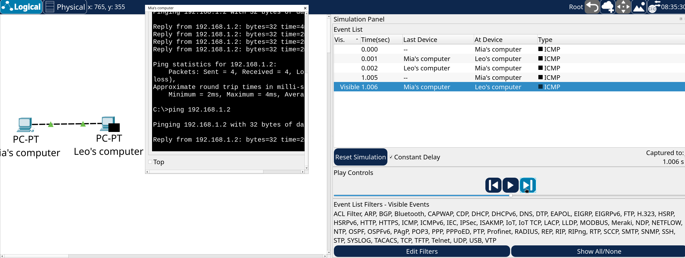
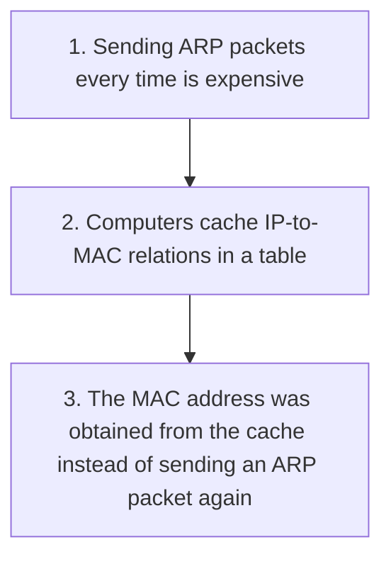
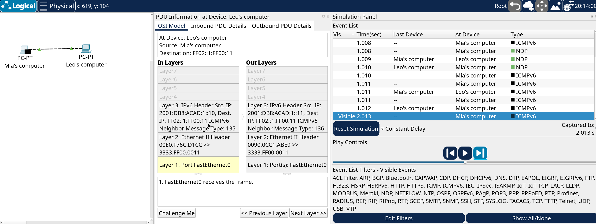

# PKT
- IPv4: a version with IPv4 ([solution_1_icmp_ipv4.pkt](solution_1_icmp_ipv4.pkt))
- IPv6: a version with IPv6 ([solution_1_icmp_ipv6.pkt](solution_1_icmp_ipv6.pkt))
# Decisions
## Copper cross-over as cable
- Leo's computer and Mia's computer are both PCs. They are the same type of device, so we can use a cross-over cable.
## Ethernet as interface
- Cross-over cables are a type of Ethernet cable, so they connect to the Ethernet interface.
## IPv4 as IP version
- We chose IPv4 because it's more common, but IPv6 works too.
## ICMP as a way to check the communication
- The ping command sends ICMP packets. ICMP type 8 messages are the standard way to test connectivity in this kind of situation.
# Things that caught my attention
## An ARP packet appears before the first ICMP packet (IPv4)
- Before the first ICMP packet was sent, an ARP packet was sent.

### Justification

## No ARP packet appears after the first ping (IPv4)

### Justification

## NDP instead of ARP (IPv6)

1. IPv6 uses ND (Neighbor Discovery) packets instead of ARP packets.

# Questions to review
- What's the difference between IPv6 and IPv4?
- What's the purpose of ICMP?
- What's the purpose of NDP?
- What's the purpose of ARP?
- What's the difference between ARP NDP? 
# Concepts
* Ipv4,ipv6, osi model, ICMPV4,ICMPV6, NRP, packet package, broadcast, unicast,multicast, OSI layer2, Osi layer 3, 
# Sources
- [Packet Tracer help: logical workspace](https://tutorials.ptnetacad.net/help/default/workspace_logical.htm)
- [Packet Tracer help: connections and links](https://tutorials.ptnetacad.net/help/default/connectionsLinks.htm)
- [Packet Tracer help: simulation mode](https://tutorials.ptnetacad.net/help/default/mode_simulation.htm)
- *The TCP/IP Guide* (Charles M. Kozierok): OSI Reference Model chapters
- *The TCP/IP Guide* (Charles M. Kozierok), Part II-2: ARP
- *The TCP/IP Guide* (Charles M. Kozierok), Part II-2: TCP/IP Address Resolution For IP Version 6
- *The TCP/IP Guide* (Charles M. Kozierok), Part II-6: ICMP
- [Cloudflare: What is an IP address?](https://www.cloudflare.com/learning/dns/glossary/what-is-my-ip-address/)
