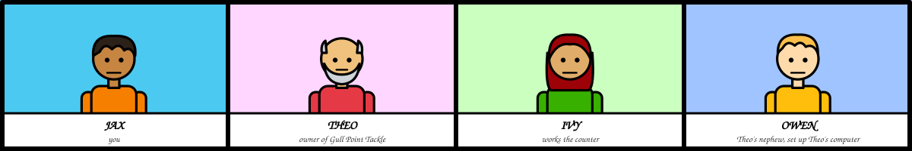
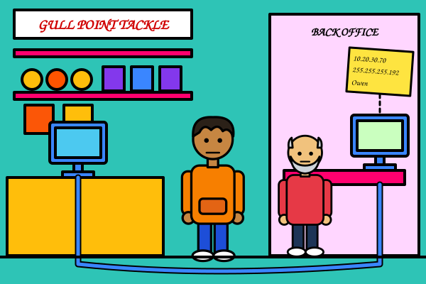
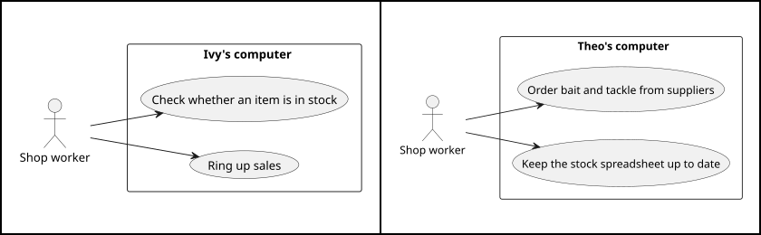
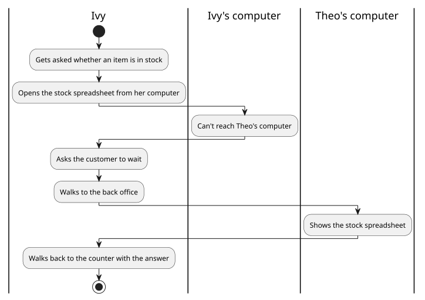

# Context

On Monday evening, Theo called. He owns Gull Point Tackle, a bait and tackle shop by the harbor, and Rosa had told him about you. His counter computer can't reach the computer in his back office. He offered 40 corins to come by the next morning. Rosa's 25 corins helped, but you're still 215 short of rent.

  
   <em>The people in this story.</em>

Gull Point Tackle is one room with a counter, and a small back office behind it. Ivy works the counter on Ivy's computer. Theo's computer sits in the back office and holds the stock spreadsheet. Years ago, Theo's nephew Owen set it up, and he left a sticky note on the screen with its IP address and mask. Last week, Theo ran a cable along the floor from Ivy's computer to his own.

  
   <em>Gull Point Tackle on Tuesday morning.</em>

  
   <em>Gull Point Tackle today.</em>

  
   <em>What each device is for.</em>

# Read this first

## Binary numbers

- **Read** *The TCP/IP Guide* (Charles M. Kozierok), sections "Binary Information and Representation: Bits, Bytes, Nibbles, Octets and Characters" and "Decimal, Binary, Octal and Hexadecimal Number Conversion".
- **Why** an IP address and a mask are both four numbers between 0 and 255, and each of those numbers is really eight bits. You'll need to switch between the two forms to make sense of Owen's note.

# The problem

## Problem 1: Ivy's computer can't reach Theo's computer

Several times an hour, a customer asks Ivy whether something is in stock. She tries to open the stock spreadsheet on Theo's computer, and her computer can't reach it. The store that sold Ivy's computer set it to IP address 10.20.30.20 with mask 255.255.255.0. Theo's computer uses the settings on Owen's note, 10.20.30.70 with mask 255.255.255.192. So today, Ivy walks to the back office and back for every question, and the customer waits.

  
   <em>How Ivy checks the stock today.</em>

## Constraints

- Nobody can change the network settings on Theo's computer. It asks for an administrator password, and only Owen knows it. Owen is working on a fishing boat until March, with no signal.
- You can change anything on Ivy's computer.
- The cable Theo ran stays. He won't buy anything else.

## What Theo wants

- From Ivy's computer, Theo's computer answers.
- From Theo's computer, Ivy's computer answers.
- A list of every IP address he could give a third computer later, so it can reach Theo's computer too. He doesn't want to call you, or wait for Owen, every time.

# Your task

* Make Ivy's computer and Theo's computer reach each other in Cisco Packet Tracer, using `PC-PT` for both. Set Theo's computer exactly as Owen's note says.
* Prove it. Packet Tracer can't open Theo's spreadsheet, so the two computers answering each other is enough.
* The list of possible Theo addresses.

# What to deliver

- `solution.pkt`, your Packet Tracer file, with the two computers working
- `SOLUTION.md`, where you
    1. Justify the settings you gave Ivy's computer.
    2. Explain why the settings from the store didn't work, even though the cable was fine.
    3. Give Theo his list of addresses, and explain how you worked it out.
    4. (Optional) Write about your experiments.

# Useful material

- [Packet Tracer help: logical workspace](https://tutorials.ptnetacad.net/help/default/workspace_logical.htm)
- [Packet Tracer help: simulation mode](https://tutorials.ptnetacad.net/help/default/mode_simulation.htm)
- *The TCP/IP Guide* (Charles M. Kozierok), section "IP Basic Address Structure and Main Components: Network ID and Host ID"
- *The TCP/IP Guide* (Charles M. Kozierok), section "IP Subnet Masks, Notation and Subnet Calculations"
