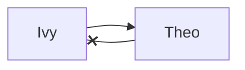
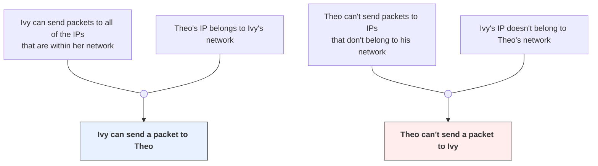

# Experimentation

The idea was to send ICMP packets from Theo to Ivy and from Ivy to Theo, and check the errors.

## From Theo to Ivy


1. Theo indicated that Ivy is in a different network.
2. Theo refused to send the ICMP packet.

## From Ivy to Theo


3. Ivy sent the packet.
4. Theo refused to respond, saying that Ivy is not in the same network.

This diagram explains the situation.



* Ivy can send packets to Theo
* Theo can't send packets to Ivy

The error messages can be interpreted in this way:


* Ivy's IP and Theo's IP belong to Ivy's network.
* Ivy's IP doesn't belong to Theo's network.



# Explanation

If you don't get it, read these sections of *The TCP/IP Guide*:

* [IP Basic Address Structure and Main Components: Network ID and Host ID](http://tcpipguide.com/free/t_IPBasicAddressStructureandMainComponentsNetworkIDa.htm)
* [IP Subnet Masks, Notation and Subnet Calculations](http://www.tcpipguide.com/free/t_IPSubnetMasksNotationandSubnetCalculations.htm)

## Seen from Ivy's computer

```
NETWORK ID                HOST ID
000010100001010000011110  00010100 : Ivy's IP
111111111111111111111111  00000000 : Ivy's mask
000010100001010000011110  00000000 : Ivy's network
000010100001010000011110  01000110 : Theo's IP
```

Here we can see that:

* The last 1 in Ivy's subnet mask is the 24th bit.
* Theo's IP and Ivy's IP share the first 24 bits.
* Theo's IP follows the structure Ivy's network ID + valid host ID.

That explains why Ivy recognizes Theo as a valid host.

## Seen from Theo's computer

```
NETWORK ID                  HOST ID
00001010000101000001111001  000110 : Theo's IP
11111111111111111111111111  000000 : Theo's mask
00001010000101000001111001  000000 : Theo's network
00001010000101000001111000  010100 : Ivy's IP
```

* The last 1 in Theo's subnet mask is the 26th bit.
* The 26th bit is different in Theo's IP and Ivy's IP.

That explains why Theo doesn't recognize Ivy as a valid host.

# Solution

The easiest way to solve the problem is to do something like this:


In practice, this means changing Ivy's configuration so that:

* It has Theo's mask.
* Ivy's IP follows the structure Theo's network + host ID.

```
11111111111111111111111111  000000 : Theo's mask
00001010000101000001111001  000000 : Theo's network
00001010000101000001111001  000001 : Ivy's new IP
```

In decimal notation:

* Ivy's new IP: 10.20.30.65
* Ivy's new mask: 255.255.255.192

I used Python to convert decimal into binary and generate the IP: [ips.py](python/ips.py). The `ipaddress` library facilitates the work. I also used it to generate all the valid IP addresses.


The available IP addresses:

```
Number of available host IPs: 60
Available IPs: [IPv4Address('10.20.30.66'), IPv4Address('10.20.30.67'), IPv4Address('10.20.30.68'), IPv4Address('10.20.30.69'), IPv4Address('10.20.30.71'), IPv4Address('10.20.30.72'), IPv4Address('10.20.30.73'), IPv4Address('10.20.30.74'), IPv4Address('10.20.30.75'), IPv4Address('10.20.30.76'), IPv4Address('10.20.30.77'), IPv4Address('10.20.30.78'), IPv4Address('10.20.30.79'), IPv4Address('10.20.30.80'), IPv4Address('10.20.30.81'), IPv4Address('10.20.30.82'), IPv4Address('10.20.30.83'), IPv4Address('10.20.30.84'), IPv4Address('10.20.30.85'), IPv4Address('10.20.30.86'), IPv4Address('10.20.30.87'), IPv4Address('10.20.30.88'), IPv4Address('10.20.30.89'), IPv4Address('10.20.30.90'), IPv4Address('10.20.30.91'), IPv4Address('10.20.30.92'), IPv4Address('10.20.30.93'), IPv4Address('10.20.30.94'), IPv4Address('10.20.30.95'), IPv4Address('10.20.30.96'), IPv4Address('10.20.30.97'), IPv4Address('10.20.30.98'), IPv4Address('10.20.30.99'), IPv4Address('10.20.30.100'), IPv4Address('10.20.30.101'), IPv4Address('10.20.30.102'), IPv4Address('10.20.30.103'), IPv4Address('10.20.30.104'), IPv4Address('10.20.30.105'), IPv4Address('10.20.30.106'), IPv4Address('10.20.30.107'), IPv4Address('10.20.30.108'), IPv4Address('10.20.30.109'), IPv4Address('10.20.30.110'), IPv4Address('10.20.30.111'), IPv4Address('10.20.30.112'), IPv4Address('10.20.30.113'), IPv4Address('10.20.30.114'), IPv4Address('10.20.30.115'), IPv4Address('10.20.30.116'), IPv4Address('10.20.30.117'), IPv4Address('10.20.30.118'), IPv4Address('10.20.30.119'), IPv4Address('10.20.30.120'), IPv4Address('10.20.30.121'), IPv4Address('10.20.30.122'), IPv4Address('10.20.30.123'), IPv4Address('10.20.30.124'), IPv4Address('10.20.30.125'), IPv4Address('10.20.30.126')]
```

## Conclusions

* Hosts can interpret IP addresses in different ways depending on the subnet mask they have.
* Hosts can send packets directly to IPs that share their first _n_ bits, where _n_ is the prefix length (except when these IPs are reserved for something else, such as the broadcast address).
* Understanding the problem without converting IPs to binary numbers would have been really hard. We have to choose the right way to represent information when solving problems.
