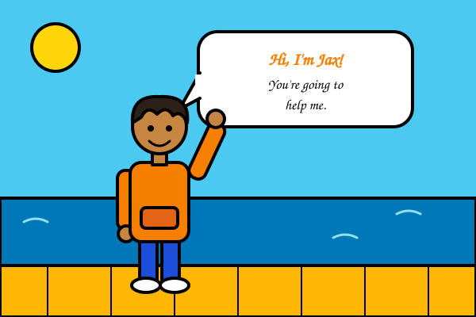

Jax lost his call center job in Harbor Hill. Now he takes small network jobs from his neighbors to pay the rent. Each problem here is one of those jobs, and you're the one who has to make it work.

<p align="center">
  
</p>

Here, you learn by doing, and you do it in Packet Tracer, a beginner-friendly network simulator. The problems are sequential, so each one builds on the one before. You'll start by connecting two PCs, then move on to switches, routers and more.
# Problems
- [No players found](00-no-players-found/)
# Project structure
```
.
├── README.md                 this file
├── img/                      images for this file
└── 00-no-players-found/      one directory per problem
    ├── README.md             the problem
    ├── SOLUTION.md           my solution and what I learned
    ├── pkt/                  my Packet Tracer files
    └── img/                  images and diagrams
```
# When you get stuck
- You can ask an AI to suggest articles, books, videos or explanations about your particular problem.
- I suggest using *The TCP/IP Guide* by Charles M. Kozierok. Search it for the topics that each problem's README covers.
# Notes
- I'm still learning. My solutions are mostly, but not entirely, accurate.
- I made the problem statements and diagrams with AI.
# Inspiration
I was tired of labs where you just follow steps. I like the format of [OverTheWire](https://overthewire.org), so I made something similar for networks. I also tried to follow [gamification principles](https://builtin.com/articles/gamification) when I made the problem statements and diagrams with AI.
